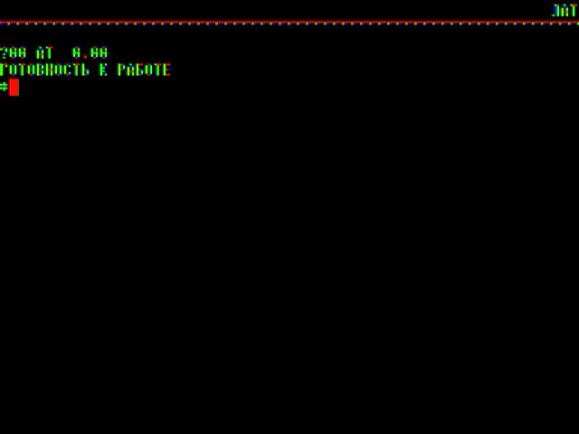

# frank-ecat

Soviet and Eastern-bloc home and office computers on a single RP2350. It runs
on the [FRANK](https://rh1.tech/projects/frank) M2 /
[Murmulator](https://murmulator.ru) 2.0 board, with HDMI video and sound, a USB
keyboard, and disk and tape images on a microSD card.



The emulation is [eCat3](https://github.com/Ptr314/ecat3) by Mikhail Revzin, a
universal emulator of the computers of the USSR and its neighbours, compiled
for the microcontroller. The machines are grouped into families; each family is
one firmware, with its configurations and ROMs built into flash.

- 1024x768 HDMI (the RP2350's HSTX), each machine's picture scaled to fit and
  centred, at the machine's own frame rate
- sound over HDMI, or from the board's I2S DAC
- tape recorders and floppy drives: images load from the card through a file
  browser
- both cores of the RP2350 where one is not enough (ДВК, УК-НЦ, МС 0585, Поиск)
- menus for the files and the settings, in the colours of a Soviet manual

## Machines

| Firmware | Machines |
|---|---|
| `rk86` | Радио-86РК, Спектр-001, Микроша, Апогей БК-01Ц |
| `agat` | Агат-7 (140 KB and 840 KB drives, -pp, -max), Агат-9 (-pp, ЯЗС) |
| `bk` | БК0010, БК0010-01, БК0011М: plain, with the КНГМД, А16М or СМК-512; БК0011М МСТД |
| `dvk` | ДВК-1, ДВК-2 (ИЕ15), ДВК-3 (КСМ, КГД), ДВК-4 (КЦГД) |
| `uknc` | УК-НЦ, УК-НЦ (031), УК-НЦ (Бейсик) |
| `e85` | Электроника МС 0585, with МС 1702, with the hard disk |
| `poisk` | Поиск-1, 128 KB, with the cartridge RAM, with the КНГМД 302 |
| `orion` | Орион-128 (М1, М3 with disks, Z80 Card II) |
| `irisha` | Ириша (ГМД-70, КНГМД), Диалог, Каспий |
| `unior` | Юниор ФВ-6506, Арго ФВ-6511 |
| `pravetz` | Правец-82, -8М, -8А, -8А (full), -8С (Apple II), Правец-8Д (Oric) |

Most machines run at full speed. Three run close to it: ДВК-4 at about 90%
(4.9 of 5.5 MHz), УК-НЦ at 85-100% in a fast mode (RT-11 boots from its disk),
and МС 0585 at 65-85% while it loads.

## Hardware

- FRANK M2 / Murmulator 2.0 with an RP2350B, 16 MB of flash and 8 MB of QSPI
  PSRAM (chip select on GPIO 47)
- HDMI on GPIO 12-19
- microSD on SPI0: SCK 6, MOSI 7, MISO 4, CS 5
- USB keyboard on the board's USB-C port
- optional I2S DAC: DATA 9, BCLK 10, LRCK 11

## Installing

1. Pick the release's firmware for the family you want, for example
   `m2p2_frank-ecat-bk_1_00.uf2`. Hold BOOTSEL, plug the board in, and copy
   it to the RP2350 drive (or `picotool load -x FILE.uf2`).
2. Unpack `frank-ecat-sdcard_1_00.zip` onto a FAT32 microSD card. It holds
   disk and tape images, one folder per machine type:

   ```
   /ecat/software/bk/andos330.img
   /ecat/software/agat/GAMES.DSK
   /ecat/software/radio-86rk/XONIX.RKR
   ...
   ```

   Your own images go into the same folders. The ROMs are in the firmware,
   so the card holds software only. Without a card the machines still start,
   with empty drives.
3. Plug in a USB keyboard and an HDMI display, and power the board.

To change family, flash another firmware; the card stays the same.

## Using it

At power-on the family's models are listed for 3 seconds with the last one
used marked. Press a key to pick another.

- **F11**: the file browser, opening in the machine's software folder. A
  program loads into memory, a tape image goes on the machine's tape
  recorder, a disk image into its drive.
- **F12**: the settings: model, reset, the tape transport, HDMI or I2S sound,
  volume, emulator info, and "Save settings to the card", which writes
  `/ecat/frank.ini`.

The machine stands still while a menu is open.

## Building

You need the [Pico SDK](https://github.com/raspberrypi/pico-sdk) 2.2
(`PICO_SDK_PATH`, default `~/pico/pico-sdk`), the Arm GNU toolchain, CMake,
Ninja and Python 3.

The `.ext` machines are flattened at build time by eCat3's own console build,
so build that on the host first:

    cmake -S ecat3/src -B build-host -G Ninja -DCMAKE_BUILD_TYPE=Release -DENABLE_GUI=OFF -DENABLE_HEADLESS=ON
    cmake --build build-host

Then the firmware:

    CONSOLE=uart ./build.sh                  # every family, USB keyboard
    CONSOLE=uart ./build.sh frank-ecat-bk    # one family
    ./release.sh 1.00                        # the release UF2s and the card ZIP

`CONSOLE=uart` makes the USB port the keyboard host, with the debug console
on UART0 (GPIO 0/1). The default, `CONSOLE=usb`, makes the USB port a CDC
console instead, for development: no keyboard, but the console drives the
machine, and `./flash.sh frank-ecat-bk` reflashes the board without touching
it.

Console commands (USB CDC): a typed line goes to the machine's keyboard;
`~C m~` opens the settings and `~C files~` the files, `~C boot~` restarts to
the model list, `~C m N~` switches to model N, `~C k down ret~` sends keys
(cursor, `esc`, `tab`, `bs`, `f1`..), `~C s~` prints the status, `~C prof~` a
sampling profile (`tools/prof.py`), `~BOOT~` reboots into BOOTSEL and `~RST~`
reboots. Every firmware feeds a watchdog: after a hang it prints where it
stopped and enters BOOTSEL by itself.

eCat3 is vendored in `ecat3/`, with every change guarded by `ECAT_EMBEDDED` and
listed in `ecat3/PATCHES.md`; `tools/host_check.sh` runs eCat3's own tests on
the patched core.

## Contributing

Install the hooks once per clone:

    tools/install-hooks.sh

They refuse commits whose message or identity credits an AI tool
(`tools/check-attribution.sh`); the same check runs on GitHub for every push
and pull request.

## Acknowledgements

The emulator
- **Mikhail Revzin**: [eCat3](https://github.com/Ptr314/ecat3), the
  emulator, its machine configurations and ROM sets, and
  [dsk_tools](https://github.com/Ptr314/dsk_tools)

Libraries and drivers
- **drewpo28 and the pico-spec authors**:
  [pico-speccy](https://github.com/drewpo28/pico-speccy), the HDMI driver with
  its HSTX back-end and audio data islands, and the menu navigation; after
  [ESPectrum](https://github.com/EremusOne/ESPectrum) and DnCraptor's
  [pico-spec](https://github.com/DnCraptor/pico-spec)
- **Raspberry Pi Ltd**: the [Pico SDK](https://github.com/raspberrypi/pico-sdk)
- **Ha Thach**: [TinyUSB](https://github.com/hathach/tinyusb)
- **ChaN**: [FatFs](http://elm-chan.org/fsw/ff/)
- **Elehobica**: the microSD SPI driver, from
  [pico_fatfs](https://github.com/elehobica/pico_fatfs)
- **Doug Lea**: dlmalloc, the PSRAM heap

RP2350 port
- **Mikhail Matveev** ([rh1.tech](https://rh1.tech), xtreme@rh1.tech): the
  port to RP2350, the board support (from
  [frank-quake2](https://github.com/rh1tech/frank-quake2) and frank-castle),
  the menus (from frank-dino) and the speed work

## License

frank-ecat is released under the GNU General Public License, version 3 or
later (see `LICENSE`).

- The project's own code is Copyright (c) 2026 Mikhail Matveev
  ([rh1.tech](https://rh1.tech)), GPL-3.0-or-later.
- eCat3 (`ecat3/`) is GPL-3.0, Copyright (c) Mikhail Revzin.
- The other parts keep the licences in their headers: MIT (TinyUSB code and
  the USB HID host), BSD (FatFs, the microSD driver, the Pico SDK) and public
  domain (dlmalloc).

The machines' ROMs and the sample software belong to their owners and are
included as eCat3 ships them.
